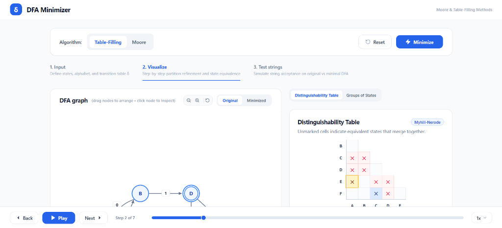

# DFA Minimization Studio & Simulator

[](https://python.org)
[](https://fastapi.tiangolo.com)
[](https://react.dev)
[](https://vitejs.dev)
[](https://tailwindcss.com)
[](https://dfa-minimizer-whzn-k4864nvjn-nishtha-1111s-projects.vercel.app/)
[](https://dfa-minimizer-6jui.onrender.com/docs)
[](https://opensource.org/licenses/MIT)

---

## 1. Project Overview

**DFA Minimization Studio & Simulator** is an interactive educational and research tool designed for students, educators, and engineers studying **Theory of Computation** and **Formal Languages**.

Given an arbitrary Deterministic Finite Automaton (DFA), this platform automates the elimination of dead and unreachable states, executes formal minimization algorithms step-by-step, and provides real-time dual-machine string execution to prove language equivalence.

The repository provides two complete interfaces:
1. **Full-Stack Edition**: A modern **React 18 + Vite + Tailwind CSS** frontend paired with a high-performance **FastAPI** REST backend.
2. **Streamlit Studio**: A standalone Python web application designed for rapid experimentation and one-click cloud deployment.

---

## 2. Live Demo

- **Frontend (Production Web UI)**: [https://dfa-minimizer-whzn-k4864nvjn-nishtha-1111s-projects.vercel.app](https://dfa-minimizer-whzn-k4864nvjn-nishtha-1111s-projects.vercel.app/) *(Hosted on Vercel)*
- **Backend API & Swagger Docs**: [https://dfa-minimizer-6jui.onrender.com/docs](https://dfa-minimizer-6jui.onrender.com/docs) *(Hosted on Render)*
- **Streamlit Community Cloud**: [Deploy via share.streamlit.io](https://share.streamlit.io)

---

## 3. Application Screenshots

| Interactive DFA Minimizer (React + Tailwind + Vite) |
|:---:|
|  |
| *Visual interactive graph with draggable SVG nodes, active pair highlighting, animated distinguishability table, and step-by-step playback scrubber.* |

---

## 4. Key Features

- **Interactive DFA Designer**:
  - Add, rename, or delete states, alphabet symbols, and transitions.
  - Configure start and accepting (final) states with instantaneous validation.
  - Preloaded textbook examples (Equivalent states, Unreachable states, Complex multi-cycle DFAs).

- **Automated Reachability & Completeness Check**:
  - Breadth-First Search (BFS) reachability analysis to prune dead or unreachable states.
  - Automatic trap/dead state detection and completion.

- **Multi-Algorithm Minimization Engine**:
  - **Myhill-Nerode Table-Filling**: Lower-triangular matrix tracking distinguishable pairs \((p, q)\).
  - **Moore's Partition Refinement**: Signature-based \(k\)-equivalence state splitting.
  - **Hopcroft's Algorithm**: Optimal worklist-driven partition refinement.

- **Step-by-Step Interactive Playback**:
  - Play, Pause, Step Next, and Step Back through algorithm executions.
  - Dynamic scrubber bar and adjustable playback speed (\(0.5\times\) to \(2\times\)).
  - Synchronized mathematical explanations and formal LaTeX set notations at every step.

- **Dual-Machine String Verification & Tape Runner**:
  - Executes test strings concurrently on both the **Original DFA** and the **Minimized DFA**.
  - Visualizes traversed state paths (\(q_0 \to q_1 \to \dots\)) on both machines.
  - Confirms language equivalence: both machines yield identical acceptance verdicts.
  - Batch test runner to validate collections of strings against edge cases (e.g., empty string \(\varepsilon\)).

---

## 5. DFA Minimization: How It Works

A Deterministic Finite Automaton (DFA) is formally defined as a 5-tuple:
\[
M = (Q, \Sigma, \delta, q_0, F)
\]
Where:
- \(Q\): Finite set of states
- \(\Sigma\): Finite set of input symbols (alphabet)
- \(\delta: Q \times \Sigma \to Q\): Transition function
- \(q_0 \in Q\): Initial (start) state
- \(F \subseteq Q\): Set of final (accepting) states

### Minimization Pipeline

```
  ┌─────────────────┐     ┌───────────────────────┐     ┌───────────────────────┐
  │  Input DFA (M)  │ ──► │  1. Reachability (BFS)│ ──► │  2. 0-Equivalence (F)  │
  └─────────────────┘     │  Prune unreachables   │     │  Split F and Q \ F    │
                          └───────────────────────┘     └───────────────────────┘
                                                                    │
  ┌─────────────────┐     ┌───────────────────────┐                 ▼
  │  Minimized DFA  │ ◄── │  4. State Merging     │ ◄── ┌───────────────────────┐
  │     (M_min)     │     │  Equivalence classes  │     │  3. Partition Refine  │
  └─────────────────┘     └───────────────────────┘     │  Hopcroft / Moore     │
                                                        └───────────────────────┘
```

1. **Unreachable State Removal**: Perform BFS traversal starting from \(q_0\). Any state \(q \notin \text{Reachable}(q_0)\) is eliminated:
   \[
   Q' = \{ q \in Q \mid \exists w \in \Sigma^*, \; \hat{\delta}(q_0, w) = q \}
   \]
2. **Initial Partitioning (0-Equivalence)**: Separate states into accepting and non-accepting sets:
   \[
   P_0 = \{ F, \; Q' \setminus F \}
   \]
3. **Iterative Refinement**:
   Two states \(p, q\) belong to the same block in \(P_{k+1}\) if and only if:
   \[
   p, q \in B_i \in P_k \quad \text{and} \quad \forall a \in \Sigma, \; \delta(p, a) \text{ and } \delta(q, a) \text{ belong to the same block in } P_k
   \]
4. **State Merging**: Collapse each final equivalence block \([q]\) into a single composite state.
5. **Language Invariance Verification**:
   The minimized DFA \(M_{\min}\) is guaranteed to accept the exact same regular language:
   \[
   L(M) = L(M_{\min})
   \]

---

## 6. Supported Algorithms & Complexity Comparison

| Algorithm | Worst-Case Time Complexity | Space Complexity | Description & Mechanism | Supported Editions |
|---|:---:|:---:|---|:---:|
| **Hopcroft's Algorithm** | \(O(\|\Sigma\| \cdot \|Q\| \log \|Q\|)\) | \(O(\|\Sigma\| \cdot \|Q\|)\) | Uses a worklist of potential splitter sets; splits blocks only against the smaller sub-partition. | Backend / Streamlit |
| **Moore's Algorithm** | \(O(\|\Sigma\| \cdot \|Q\|^2)\) | \(O(\|Q\|)\) | Successively computes \(k\)-equivalence classes by encoding transition destination signatures. | Full-Stack & Streamlit |
| **Myhill-Nerode Table-Filling** | \(O(\|\Sigma\| \cdot \|Q\|^2)\) | \(O(\|Q\|^2)\) | Constructs a lower-triangular matrix of pairs \((p, q)\) and iteratively marks distinguishable pairs. | Full-Stack (React + FastAPI) |

---

## 7. Application Architecture

```
┌────────────────────────────────────────────────────────────────────────┐
│                   CLIENT LAYER (React 18 + Vite)                       │
│                                                                        │
│   [Interactive SVG Graph]    [Distinguishability Table]   [Tape Runner]│
│   - Draggable state nodes    - Dynamic lower-triangular   - Step paths │
│   - Curve-routed transitions - Color-coded markings       - Dual diffs │
│                                                                        │
│   [Playback Controller] ── Back | Play | Pause | Next | Speed | Scrubber│
└────────────────────────────────────┬───────────────────────────────────┘
                                     │ JSON / HTTP REST
                                     ▼
┌────────────────────────────────────────────────────────────────────────┐
│                   BACKEND LAYER (FastAPI + Python 3.10+)               │
│                                                                        │
│   • POST /api/validate ── Symbol & completeness check + dead detection │
│   • POST /api/minimize ── BFS pruning + Step-by-step algorithm trace   │
│   • POST /api/simulate ── Dual-DFA concurrent string traversal         │
│   • GET  /api/health   ── Service status and uptime monitor            │
│   • GET  /docs         ── OpenAPI Swagger documentation                │
└────────────────────────────────────────────────────────────────────────┘
```

---

## 8. Project Directory Structure

```
dfa-minimizer/
├── frontend/                     # Modern React + Vite + Tailwind CSS Application
│   ├── src/
│   │   ├── algorithms/           # Client-side helpers and algorithms
│   │   ├── components/
│   │   │   ├── controls/         # PlaybackBar, Scrubber, Speed dropdown
│   │   │   ├── layout/           # TopBar, ControlBar
│   │   │   ├── tabs/             # InputTab, TestStringsTab, TabNavigation
│   │   │   └── visualize/        # GraphCard, TableFillingCard, GroupsCard
│   │   ├── presets/              # Textbook DFA sample models
│   │   ├── services/             # API client (Vercel & Render environment-aware)
│   │   └── types/                # TypeScript interface definitions (DFA, Trace)
│   ├── vercel.json               # SPA rewrite rules for Vercel deployment
│   ├── package.json              # Frontend scripts and npm dependencies
│   └── vite.config.ts            # Vite bundler configuration & proxy
│
├── backend/                      # High-Performance FastAPI REST Service
│   ├── app/
│   │   ├── main.py               # REST API endpoints & static asset serving
│   │   ├── models.py             # Pydantic schemas for requests, responses & traces
│   │   └── algorithms/           # Algorithmic trace generation engines
│   │       ├── hopcroft.py       # Hopcroft partition refinement
│   │       ├── moore.py          # Moore's k-equivalence algorithm
│   │       ├── table_filling.py  # Myhill-Nerode lower-triangular table filling
│   │       ├── simulator.py      # Dual-machine string execution
│   │       ├── unreachable.py    # BFS reachability analysis
│   │       └── validator.py      # Input validation & completeness check
│   ├── tests/                    # Backend pytest suite
│   │   └── test_api.py           # API endpoint integration tests
│   └── requirements.txt          # Backend-specific dependencies
│
├── dfa_minimization_studio/      # Standalone Streamlit Application
│   ├── app.py                    # Streamlit entrypoint
│   ├── core/                     # Automata engine (dfa.py, validator, simulator, samples)
│   ├── algorithms/               # Hopcroft & Moore implementations
│   ├── visualization/            # Graphviz DOT state diagram generators
│   └── ui/                       # Streamlit tab views (Designer, Minimizer, Testing)
│
├── assets/screenshots/           # Screenshots and demo media for repository
│   └── demo.png                  # Showcase preview of the React application
├── requirements.txt              # Unified Python requirements
├── packages.txt                # System packages for container environments (graphviz)
└── run_all.py                    # Concurrent local development runner
```

---

## 9. Installation & Local Setup

### Prerequisites
- **Python**: 3.10 or higher
- **Node.js**: 18.x or higher
- **npm**: 9.x or higher

---

### Option A: Run Full-Stack Web Application (Recommended)

1. **Clone the repository**:
   ```bash
   git clone https://github.com/Nishtha-1111/dfa-minimizer.git
   ```

2. **Enter the project directory**:
   ```bash
   cd dfa-minimizer
   ```

3. **Install backend dependencies**:
   ```bash
   pip install -r backend/requirements.txt
   ```

4. **Install frontend dependencies**:
   ```bash
   cd frontend
   npm install
   cd ..
   ```

5. **Launch both backend and frontend concurrently**:
   ```bash
   python run_all.py
   ```

- **Frontend**: [http://localhost:5173](http://localhost:5173)
- **Backend API**: [http://127.0.0.1:8000](http://127.0.0.1:8000)
- **Interactive Swagger Docs**: [http://127.0.0.1:8000/docs](http://127.0.0.1:8000/docs)

---

### Option B: Run Standalone Streamlit Studio

1. **Install Python dependencies**:
   ```bash
   pip install -r requirements.txt
   ```

2. **Launch Streamlit**:
   ```bash
   streamlit run dfa_minimization_studio/app.py
   ```
   Open **http://localhost:8501** in your browser.

---

## 10. How to Use the Application

1. **Step 1: Input the DFA**:
   - Choose a textbook preset from the top bar (e.g., *Equivalent States*, *Unreachable States*) or enter states, alphabet, and transitions manually.
   - Designate the initial state and accepting states.
2. **Step 2: Choose Minimization Algorithm**:
   - Select **Table-Filling** (Myhill-Nerode) or **Moore's Algorithm** from the segmented toggle.
   - Click the **Minimize** button.
3. **Step 3: Step-by-Step Visualization**:
   - Inspect the interactive graph with draggable states.
   - Watch the lower-triangular distinguishability table or partition blocks update at every step.
   - Use the sticky playback bar to pause, step forward, or adjust animation speed.
4. **Step 4: Test String Equivalence**:
   - Switch to the **Test Strings** tab.
   - Enter any test string (e.g. `0101`, or leave blank for empty string \(\varepsilon\)).
   - Observe the concurrent step-by-step state traversal paths and verify that both machines reach identical acceptance verdicts.

---

## 11. API Documentation

The FastAPI backend exposes RESTful endpoints for integration with external tools:

| Method | Endpoint | Description | Request Body | Response |
|---|---|---|---|---|
| `GET` | `/` | Service root and health greeting | None | JSON status object |
| `GET` | `/api/health` | Health check endpoint | None | `{"status": "ok"}` |
| `POST` | `/api/validate` | Validates DFA completeness and reachability | `{"dfa": DFAModel}` | `ValidationResponse` |
| `POST` | `/api/minimize` | Executes minimization and returns step-by-step trace | `{"dfa": DFAModel, "algorithm": "table_filling"}` | `MinimizeResponse` |
| `POST` | `/api/simulate` | Concurrently executes input string on original and minimal DFAs | `{"original_dfa": ..., "minimal_dfa": ..., "input_string": "..."}` | `SimulateResponse` |
| `GET` | `/docs` | Interactive Swagger API Explorer | None | OpenAPI HTML UI |

---

## 12. Deployment Instructions

### Deploy Frontend on Vercel
1. Go to [vercel.com](https://vercel.com) and import the repository.
2. Set **Root Directory** to `frontend`.
3. Add the Environment Variable:
   - **Key**: `VITE_API_BASE_URL`
   - **Value**: `https://dfa-minimizer-6jui.onrender.com`
4. Click **Deploy**.

### Deploy Backend on Render
1. Go to [render.com](https://render.com) and create a new **Web Service**.
2. Select your repository and configure:
   - **Environment**: `Python 3`
   - **Build Command**: `pip install -r backend/requirements.txt`
   - **Start Command**: `uvicorn backend.app.main:app --host 0.0.0.0 --port $PORT`
   - **Instance Type**: `Free`
3. Click **Create Web Service**.

### Deploy on Streamlit Community Cloud
1. Connect repository on [share.streamlit.io](https://share.streamlit.io).
2. Set **Main file path** to: `dfa_minimization_studio/app.py`.
3. Click **Deploy!**

---

## 13. Testing

Run automated pytest suites to verify algorithmic correctness, partition invariance, and API endpoints:

```bash
# 1. Run Backend API Tests
python -m pytest backend/tests -v

# 2. Run Minimization Studio Tests
python -m pytest dfa_minimization_studio/tests -v
```

All test cases verify:
- Reachability BFS pruning of unreachable states.
- Exact equivalence between original and minimized state machines.
- Correctness of partition refinement steps on textbook automata.
- Edge cases: single-state machines, all-accepting, zero-accepting, and disconnected states.

---

## 14. Future Enhancements

- [ ] **NFA to DFA Conversion (Subset Construction)**: Convert Non-deterministic Finite Automata to equivalent DFAs before minimization.
- [ ] **Regular Expression to DFA**: Compile regex patterns directly into minimal DFAs using Thompson's construction and Glushkov's algorithm.
- [ ] **State Machine Export**: Export minimal state diagrams to SVG, PNG, LaTeX TikZ, and JSON formats.
- [ ] **Mealy & Moore Machine Support**: Extend the minimization framework to finite state transducers with outputs.

---

## 15. License

This project is open-source and distributed under the **MIT License**. See the `LICENSE` file for details.

---

## 16. Acknowledgements & References

- **John E. Hopcroft, Rajeev Motwani, Jeffrey D. Ullman**: *Introduction to Automata Theory, Languages, and Computation* (3rd Edition).
- **Michael Sipser**: *Introduction to the Theory of Computation* (3rd Edition).
- **FastAPI**: Modern, fast web framework for building APIs with Python.
- **Vite & React**: Next Generation Frontend Tooling.
